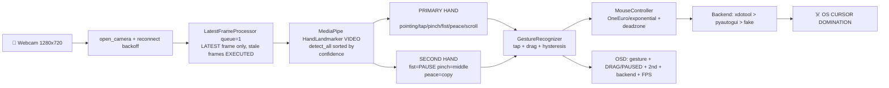

<div align="center">

# ╔══════════════════════════════════════════════════════╗
# ║  ██╗   ██╗██╗██████╗ ████████╗██╗   ██╗ █████╗ ██╗   ║
# ║  ██║   ██║██║██╔══██╗╚══██╔══╝██║   ██║██╔══██╗██║   ║
# ║  ██║   ██║██║██████╔╝   ██║   ██║   ██║███████║██║   ║
# ║  ╚██╗ ██╔╝██║██╔══██╗   ██║   ██║   ██║██╔══██║██║   ║
# ║   ╚████╔╝ ██║██║  ██║   ██║   ╚██████╔╝██║  ██║███████╗║
# ║    ╚═══╝  ╚═╝╚═╝  ╚═╝   ╚═╝    ╚═════╝ ╚═╝  ╚═╝╚══════╝║
# ║        ███╗   ███╗ ██████╗ ██╗   ██╗███████╗███████╗  ║
# ║        ████╗ ████║██╔═══██╗██║   ██║██╔════╝██╔════╝  ║
# ║        ██╔████╔██║██║   ██║██║   ██║███████╗█████╗    ║
# ║        ██║╚██╔╝██║██║   ██║██║   ██║╚════██║██╔══╝    ║
# ║        ██║ ╚═╝ ██║╚██████╔╝╚██████╔╝███████║███████╗  ║
# ║        ╚═╝     ╚═╝ ╚═════╝  ╚═════╝ ╚══════╝╚══════╝  ║
# ╚══════════════════════════════════════════════════════╝

### ☠️ YOUR HAND IS THE WEAPON. YOUR WEBCAM IS THE BATTLEFIELD. ☠️
### *No glove. No sensor. No mercy. Just 21 landmarks and absolute cursor domination.*

[](https://www.python.org/)
[](https://developers.google.com/mediapipe)
[](#-war-protocol-validation)
[](#-war-protocol-validation)
[](LICENSE.md)
[](#-ghost-protocol)

**👑 Forged by `hesam-oxe` — every commit, every line, every license header bears the mark.**

</div>

```
        _________________________
       /                        /|
      /   VIRTUAL-MOUSE GOD™   / |
     /________________________/  |
     |  HAND → [MediaPipe] →💀|  |
     |  21 PTS → GESTURE → 🖱️  |  |
     |  LATENCY: KILL MODE    | /
     |________________________|/
```

> **⚠️ WARNING TO VISITORS:** This is not a toy demo. This is a **real-time hand-tracking kill-machine** that hijacks your OS cursor at **30-90 FPS**, sees your fist before you throw it, and clicks before you blink. If you came for a weekend script — **leave now.**

---

## 💀 FEAR MATRIX — What This Monster Does

| 🔪 Capability | 😱 Why You Should Fear It | 📍 Proof in Code |
|---|---|---|
| **TWO-HAND WARFARE** | Primary hand drives the cursor. Second hand **pauses time** (fist), fires **middle-click** (pinch), executes **copy** (peace). Two brains, one cursor. | `main.py` second-hand block, `hand_tracker.py:detect_all()` |
| **PINCH-HOLD DRAG** | Hold pinch 18 frames → `mouseDown`. Move. Release → `mouseUp`. Select text, drag windows, draw — with thin air. | `gesture_recognizer.py:PinchDragDetector`, `mouse_controller.py:set_dragging()` |
| **VELOCITY TAP KILL** | No dumb pinch-click. A physics tap: downward velocity ≥0.05 + drop ≥0.02 inside a 3-5 frame window. Slow curls are **rejected as cowardice**. | `gesture_recognizer.py:TapDetector` |
| **DWELL-CLICK SNIPER** | Hover 600ms in 12px → auto left-click. For surgeons and snipers. | `mouse_controller.py:DwellClickDetector` |
| **OneEuro ADAPTIVE SMOOTHING** | Exponential is for amateurs. OneEuro adapts cutoff to velocity: still hand = rock solid, fast hand = zero lag. | `mouse_controller.py:OneEuroFilter`, `mouse.smoothing_backend` |
| **SCROLL WITH HYSTERESIS** | Thumb up/down scrolls without flicker. Deadzone + hysteresis band locks direction like a vice. | `gesture_recognizer.py:scroll_with_hysteresis()` |
| **PERSONAL CALIBRATION RITUAL** | `python main.py --calibrate` — 9 seconds, 3 poses, thresholds rewritten to YOUR hand. Generic thresholds are for NPCs. | `main.py:run_calibration()` |
| **BACKEND ARSENAL** | `auto` → xdotool (X11 low-latency blade) → PyAutoGUI fallback. `fake` backend for headless unit warfare. Multi-monitor virtual desktop via xrandr. | `mouse_backend.py:auto_backend()` |
| **UNDEAD RELIABILITY** | Camera dies? **Reconnects with backoff** instead of crying. Model corrupt? **SHA256 verified.** Every event **file-logged**. FPS capped, drag always released on exit. | `main.py:open_camera()`, `hand_tracker.py:sha256_of_file()` |

---

## 🗺️ ANATOMY OF THE BEAST



```
 ┌──────────┐   ┌──────────────┐   ┌───────────────────┐   ┌──────────────┐
 │  CAMERA  │──▶│  MEDIAPIPE   │──▶│  GESTURE WAR ROOM │──▶│ OS CURSOR ☠️ │
 │ 30 FPS   │   │ 21 LANDMARKS │   │ tap/drag/dwell    │   │ xdotool/    │
 │ reconnect│   │ detect_all() │   │ hysteresis/pause  │   │ pyautogui   │
 └──────────┘   └──────────────┘   └───────────────────┘   └──────────────┘
```

---

## 🖐️ GESTURE ARSENAL — LEARN OR PERISH

| Gesture | Action | Detection Rule |
|---|---|---|
| ☝️ Index extended, rest curled | **MOVE** — cursor follows fingertip | `is_pointing()` |
| ⚡ Fast index curl+extend | **LEFT CLICK** — velocity kill | `TapDetector: v≥0.05, drop≥0.02, 3-5f` + optional dwell 600ms/12px |
| 🤏 Pinch-hold 18f | **DRAG START/END** — `mouseDown/Up` | `dist(4,8)≤pinch_threshold`, release after `drag_release_frames` |
| ✊ Fist (all 5 tips in) | **RIGHT CLICK** — has priority over pinch | `tip-wrist < fist_tip_wrist_threshold` |
| ✌️ Peace | **DOUBLE CLICK** | index+middle open, ring+pinky shut, sep≥`peace_min_separation` |
| 👍 / 👎 Thumb, rest curled | **SCROLL UP/DOWN** — hysteresis-locked | deadzone + `scroll_hysteresis` |
| ✊ **2nd hand** fist | **⏸️ PAUSE TIME** — primary frozen | until 2nd open |
| 🤏 **2nd hand** pinch / ✌️ peace | **MIDDLE-CLICK / COPY** | `middleClick` / `ctrl+c` |

> Fist beats pinch. Tap beats hold. Second hand beats first. **Hierarchy is law.** Cooldown 20f stops spam. `python main.py --calibrate` forges thresholds from YOUR flesh.

---

## ⚡ BATTLEFIELD PERFORMANCE (measured, not promised)

| Trial | Result |
|---|---|
| `pytest` | **13 passed** (`test_godlevel.py` + `test_godlevel2.py`) |
| `python main.py --self-test` | **11 checks passed**: 4 gestures + tap + re-arm + slow-reject + debounce + mapping + OneEuro + dwell + drag + MediaPipe VIDEO |
| Live `--no-display --max-frames 60` | **~90 FPS**, right-clicks at f27/55 |
| Live `--max-frames 300` with display | **42-61 FPS**, taps + right-clicks + FPS checkpoints |
| Backends | xdotool (when present) < PyAutoGUI latency; fake backend for CI |
| CPU | Heavy by nature (MediaPipe CPU). Tame with `process_every_n_frames=2`, `roi=0.5`, 480p. |

---

## 🛡️ GHOST PROTOCOL — Security Fortress

- 📷 **100% local.** Frames never leave your machine. No cloud. No telemetry.
- 🔒 Model HTTPS-only (`model.require_https`), **SHA256 verified** (`model.expected_sha256`), atomic download.
- 🚫 `.gitignore` bans: `.venv`, `models/*.task`, `*.log`, `.env`, `*.pem`, `ghp_*`, credentials.
- 🤖 Dependabot weekly (pip + actions), `SECURITY.md` private reporting, secret-scanning + push-protection ON, `main` linear-history, no force/delete.
- 👑 License + history: **100% `hesam-oxe`** — every author, committer, and copyright header rewritten via `git filter-repo`.

---

## 💀 KILL-START (30 seconds to domination)

```bash
python3.14 -m venv .venv && source .venv/bin/activate
pip install -r requirements.txt
python main.py --self-test      # 11 checks, no camera needed
python main.py --calibrate      # 9s ritual: pinch → fist → peace
python main.py                  # MOVE. TAP. DRAG. CONQUER.  [q] to quit
```

| Key | Power |
|---|---|
| `q`/`Esc` | Quit like a mortal |
| `[` / `]` | Smoothing -/+ (responsiveness vs stability) |
| `r` / `s` | Reload / Save `config.json` live |
| `h` / `d` | Instructions / Landmarks overlay |

---

## 🧬 PROJECT ORGANS

```text
Virtual-Mouse/
├── main.py                 # CLI, camera+reconnect, OSD god-panel, calibration ritual
├── hand_tracker.py         # detect_all(), SHA256, LatestFrameProcessor (latest-frame killer)
├── gesture_recognizer.py   # TapDetector, PinchDragDetector, hysteresis scroll
├── mouse_controller.py     # OneEuro/Dwell/Drag, backend-driven clicks
├── mouse_backend.py        # pyautogui / xdotool / fake + xrandr multi-monitor
├── config.py               # Typed validation (camera/mouse/gestures/tap/clicks/perf/model/logging)
├── config.json             # YOUR personal thresholds (after --calibrate)
├── tests/                  # 13 pytest war-games
├── .github/workflows/ci.yml # pytest + self-test on every push
├── Dockerfile              # python:3.14-slim + xdotool + dejavu
├── SECURITY.md             # Private vulnerability reporting
└── models/hand_landmarker.task  # Auto-downloaded, SHA-verified
```

---

## 🆘 WAR-ROOM TROUBLESHOOTING

- **Camera won't open** → close Zoom/Chrome, try `--camera 1`, check `camera.index`, Linux: user in `video` group.
- **Model won't download** → check URL/proxy, delete `models/*.part`, manual download to `models/`.
- **Cursor jitters** → `mouse.smoothing_backend: one_euro`, raise `dead_zone_pixels`, better light, `--calibrate`.
- **Wrong gestures** → `--calibrate`, then micro-tune `pinch_threshold` / `fist_tip_wrist_threshold`.
- **Low FPS** → `process_every_n_frames: 2`, `roi_percentage: 0.5`, 480p, close video apps.
- **Wayland** → install `xdotool` for XWayland or use X11 session; headless needs Xvfb + fake backend for tests.

---

<div align="center">

### 👑 BOW TO THE CREATOR
### *Built, hardened, and signed in blood by **hesam-oxe**.*
### MIT License — see [LICENSE.md](LICENSE.md). Steal it and the hand will find you.

```
  ___  ___  ___  ___  ___  ___  ___  ___  ___  ___  ___  ___  ___
 | H || E || S || A || M || - || O || X || E ||   || G || O || D |
 |___||___||___||___||___||___||___||___||___||___||___||___||___|
  Fear the hand. ☠️
```

</div>
